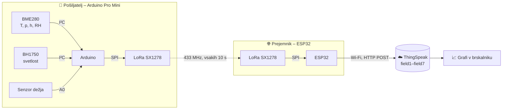
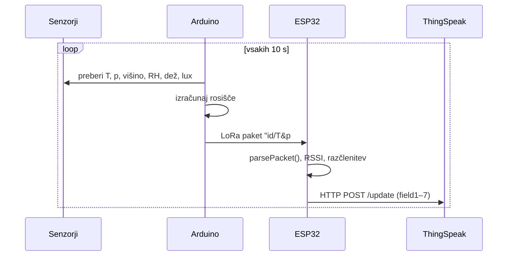
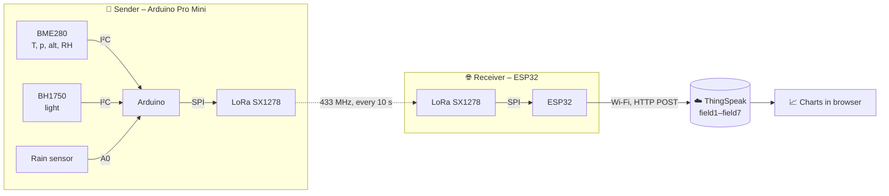

[README vremenska postaja.md](https://github.com/user-attachments/files/34875867/README.vremenska.postaja.md)
# 🌦️ LoRa vremenska postaja / LoRa Weather Station

> Brezžična vremenska postaja z **Arduinom** in **ESP32**, ki meritve prenaša prek radia **LoRa (433 MHz)** in jih objavlja v oblaku **ThingSpeak**.
> *Wireless weather station built with **Arduino** and **ESP32** that sends measurements over **LoRa (433 MHz)** and publishes them to the **ThingSpeak** cloud.*


**Jezik / Language:** [🇸🇮 Slovensko](#-slovensko) · [🇬🇧 English](#-english)

---

## 🇸🇮 SLOVENSKO

### 📖 Opis

Projekt je **vremenska postaja**, sestavljena iz dveh enot, ki med seboj komunicirata brezžično prek radijske tehnologije **LoRa**:

| Enota | Strojna oprema | Naloga |
|---|---|---|
| 📡 **Pošiljatelj** (merilna postaja) | Arduino Pro Mini + BME280 + BH1750 + senzor dežja + LoRa Ra-02, baterija Li-Po | Vsakih **10 sekund** izmeri vremenske podatke in jih pošlje po radiu. |
| 🌐 **Prejemnik** (prehod v internet) | ESP32 + LoRa modul | Sprejme paket, ga razčleni in podatke prek **Wi-Fi** pošlje na **ThingSpeak**, kjer se izrišejo v grafih. |

LoRa omogoča prenos podatkov na **velike razdalje** ob zelo **majhni porabi energije**. Merilna postaja je lahko zato postavljena zunaj, daleč od Wi-Fi omrežja, prehod ESP32 pa ostane v dosegu interneta.

### 🎯 Namen projekta

Spremljanje vremenskih razmer na oddaljeni lokaciji v realnem času in prikaz zgodovine meritev na spletu, brez potrebe po Wi-Fi povezavi na mestu meritve.

---

### ✨ Funkcionalnosti

- **7 merjenih/izračunanih veličin:**

| # | Veličina | Enota | Vir |
|---|---|---|---|
| 1 | Temperatura | °C | BME280 |
| 2 | Zračni tlak | hPa | BME280 |
| 3 | Nadmorska višina | m | BME280 (izračun iz tlaka glede na 1013,25 hPa) |
| 4 | Relativna vlažnost | % | BME280 |
| 5 | Rosišče | °C | izračun (Magnus-Tetens) |
| 6 | Padavine (mokrota senzorja) | % | analogni senzor dežja |
| 7 | Osvetljenost | lx | BH1750 |

- **Izračun rosišča** s hitro aproksimacijo **Magnus-Tetens** (`dewPointFast`):

  γ = (a·T)/(b+T) + ln(RH/100), T<sub>d</sub> = (b·γ)/(a−γ), kjer je a = 17,271 in b = 237,7 °C

- **Kalibracija senzorja dežja:** analogna vrednost se z `map()` pretvori v odstotke (780 = suho → 0 %, 0 = popolnoma mokro → 100 %) in omeji na interval 0–100 %.
- **Lasten format paketa:** vse vrednosti se pošljejo v enem nizu, ločene z različnimi znaki, ki jih prejemnik razčleni z `indexOf()` in `substring()`.
- **Identifikacija naprave:** vsak paket vsebuje `device_id`, kar omogoča razširitev na več merilnih postaj.
- **Moč signala:** prejemnik ob vsakem paketu izpiše **RSSI** (jakost sprejetega signala).
- **Oblak ThingSpeak:** ESP32 pošlje HTTP `POST` zahtevo na `/update` in vsako veličino zapiše v svoje polje (`field1`–`field7`).
- **Diagnostika prek serijskega vmesnika** (115200 baud) na obeh enotah: izpis vseh meritev, stanja LoRe, Wi-Fi povezave in IP naslova.

---

### 🏗️ Arhitektura sistema



#### 📦 Format LoRa paketa

```
MyDevice123/22.45&1008.32#42.17@55.10$12.98^0!315.83
└────┬────┘ └─┬─┘ └──┬──┘ └─┬─┘ └─┬─┘ └─┬─┘ │ └──┬──┘
 device_id   temp   tlak  višina  RH   rosišče │  svetlost
                                        padavine
```

| Ločilo | Pomen naslednje vrednosti |
|---|---|
| `/` | temperatura |
| `&` | tlak |
| `#` | nadmorska višina |
| `@` | vlažnost |
| `$` | rosišče |
| `^` | padavine |
| `!` | svetlost |

#### ☁️ Polja ThingSpeak

| Polje | Veličina |
|---|---|
| `field1` | Temperatura (°C) |
| `field2` | Tlak (hPa) |
| `field3` | Nadmorska višina (m) |
| `field4` | Vlažnost (%) |
| `field5` | Rosišče (°C) |
| `field6` | Padavine (%) |
| `field7` | Svetlost (lx) |

---

### 🔌 Strojna oprema in vezava

#### Seznam komponent

| Komponenta | Količina | Opomba |
|---|---|---|
| Arduino Pro Mini (ATmega328P, 3,3 V) | 1 | merilna postaja |
| ESP32 razvojna plošča | 1 | prejemnik in Wi-Fi prehod |
| LoRa modul Ai-Thinker Ra-02 (SX1278, 433 MHz) | 2 | napajanje **3,3 V** |
| BME280 | 1 | I²C naslov `0x76` |
| BH1750 | 1 | I²C |
| Senzor dežja YL-83 z modulom LM393 | 1 | uporabljen analogni izhod AO; potenciometer nastavlja prag za DO |
| Baterija Li-Po 3,7 V, 1000 mAh | 1 | napaja merilno postajo prek pina RAW |
| Anteni 433 MHz | 2 | LoRa modula nikoli ne zaganjaj brez antene |

#### Pošiljatelj (Arduino Pro Mini)


| Arduino Pro Mini | Naprava |
|---|---|
| D10 | LoRa NSS |
| D9 | LoRa RST |
| D2 | LoRa DIO0 |
| D11 / D12 / D13 | LoRa MOSI / MISO / SCK |
| A4 (SDA), A5 (SCL) | BME280, BH1750 |
| A0 | senzor dežja (AO) |
| VCC / GND | napajanje senzorjev in LoRa modula |
| RAW / GND | baterija Li-Po 3,7 V |

> LoRa pini so privzeti pini knjižnice `LoRa`, zato jih koda ne nastavlja posebej. Pro Mini različice 3,3 V deluje na isti napetosti kot Ra-02, zato pretvornik nivojev ni potreben.

#### Prejemnik (ESP32)


| ESP32 | LoRa modul |
|---|---|
| GPIO 5 | NSS |
| GPIO 14 | RST |
| GPIO 2 | DIO0 |
| GPIO 23 / 19 / 18 | MOSI / MISO / SCK |
| 3V3 / GND | 3,3 V / GND |

---

### 💻 Programska oprema

#### Datoteke

```
LoRa-Weather-Station/
├── docs/
│   ├── shema_posiljatelj.png   # shema vezave merilne postaje
│   └── shema_prejemnik.png     # shema vezave prejemnika
├── Posiljatelj/
│   └── Posiljatelj.ino   # Arduino: branje senzorjev, izračun rosišča, pošiljanje po LoRi
└── Prejemnik/
    └── Prejemnik.ino     # ESP32: sprejem LoRa paketa, razčlenitev, pošiljanje na ThingSpeak
```

#### Potek delovanja



#### Knjižnice

| Knjižnica | Uporaba |
|---|---|
| `LoRa` (Sandeep Mistry) | komunikacija z modulom SX1278 |
| `Adafruit BME280` + `Adafruit Unified Sensor` | temperatura, tlak, vlažnost, višina |
| `BH1750` (Christopher Laws) | osvetljenost |
| `Wire`, `SPI` | vodili I²C in SPI |
| `WiFi` (jedro ESP32) | povezava z Wi-Fi in HTTP odjemalec |

---

### 🚀 Namestitev

1. Namesti **Arduino IDE** in v *Boards Manager* dodaj podporo za **ESP32** (Espressif).
2. V *Library Manager* namesti zgoraj naštete knjižnice.
3. Ustvari kanal na [ThingSpeak](https://thingspeak.com) s **7 polji** in kopiraj *Write API Key*.
4. V `Prejemnik.ino` vnesi svoje podatke:
   ```cpp
   String apiKey = "TVOJ_WRITE_API_KEY";
   const char* ssid = "IME_WIFI_OMREZJA";
   const char* password = "GESLO_WIFI";
   ```
5. Naloži `Posiljatelj.ino` na Arduino Pro Mini (prek USB-UART pretvornika, plošča *Arduino Pro or Pro Mini*, 3,3 V / 8 MHz) in `Prejemnik.ino` na ESP32.
6. Odpri *Serial Monitor* (115200 baud) in spremljaj meritve ter pošiljanje na ThingSpeak.

> ℹ️ API ključ v izvirni kodi je bil pridobljen s šolskim računom, ki ni več aktiven, zato ni veljaven. Za delovanje je treba ustvariti svoj kanal ThingSpeak.

---

### 🔮 Možne izboljšave

- pošiljanje prek HTTPS in shranjevanje gesel v ločeni datoteki (`secrets.h`), ki ni v repozitoriju,
- samodejna ponovna povezava z Wi-Fi, če povezava pade,
- interval pošiljanja vsaj 15 s (omejitev brezplačnega računa ThingSpeak),
- način spanja (*deep sleep*) in napajanje s sončno celico za merilno postajo,
- preverjanje celovitosti paketa (kontrolna vsota) in podpora za več merilnih postaj (`device_id`),
- lastna spletna nadzorna plošča namesto ThingSpeaka.

---

### 👨‍💻 Avtor

**Jure Škrlep** · GitHub: [@JSkrlep](https://github.com/JSkrlep)

---
---

## 🇬🇧 ENGLISH

### 📖 Description

This project is a **weather station** made of two units that communicate wirelessly using **LoRa** radio:

| Unit | Hardware | Task |
|---|---|---|
| 📡 **Sender** (sensor station) | Arduino Pro Mini + BME280 + BH1750 + rain sensor + LoRa Ra-02, Li-Po battery | Every **10 seconds** it measures weather data and transmits it over radio. |
| 🌐 **Receiver** (internet gateway) | ESP32 + LoRa module | Receives the packet, parses it and sends the data over **Wi-Fi** to **ThingSpeak**, where it is plotted in charts. |

LoRa allows **long-range** data transfer with very **low power consumption**, so the sensor station can be placed outdoors, far from Wi-Fi, while the ESP32 gateway stays within internet reach.

### 🎯 Purpose

Monitoring weather conditions at a remote location in real time and viewing measurement history online, without needing Wi-Fi at the measuring site.

---

### ✨ Features

- **7 measured/calculated values:**

| # | Value | Unit | Source |
|---|---|---|---|
| 1 | Temperature | °C | BME280 |
| 2 | Air pressure | hPa | BME280 |
| 3 | Altitude | m | BME280 (calculated from pressure vs. 1013.25 hPa) |
| 4 | Relative humidity | % | BME280 |
| 5 | Dew point | °C | calculated (Magnus-Tetens) |
| 6 | Rainfall (sensor wetness) | % | analog rain sensor |
| 7 | Light intensity | lx | BH1750 |

- **Dew point** using the fast **Magnus-Tetens** approximation (`dewPointFast`), with a = 17.271 and b = 237.7 °C.
- **Rain sensor calibration:** the analog reading is mapped with `map()` (780 = dry → 0 %, 0 = fully wet → 100 %) and clamped to 0–100 %.
- **Custom packet format:** all values are sent in a single string, separated by different delimiters that the receiver parses with `indexOf()` and `substring()`.
- **Device identification:** each packet includes a `device_id`, allowing extension to multiple sensor stations.
- **Signal strength:** the receiver prints the **RSSI** of every packet.
- **ThingSpeak cloud:** the ESP32 sends an HTTP `POST` to `/update`, writing each value to its own field (`field1`–`field7`).
- **Serial diagnostics** (115200 baud) on both units: all readings, LoRa status, Wi-Fi connection and IP address.

---

### 🏗️ System architecture



**Packet format:** `device_id/temperature&pressure#altitude@humidity$dewPoint^rainfall!lux`
(e.g. `MyDevice123/22.45&1008.32#42.17@55.10$12.98^0!315.83`)

**ThingSpeak fields:** `field1` temperature · `field2` pressure · `field3` altitude · `field4` humidity · `field5` dew point · `field6` rainfall · `field7` light.

---

### 🔌 Hardware & wiring

| Component | Qty | Note |
|---|---|---|
| Arduino Pro Mini (ATmega328P, 3.3 V) | 1 | sensor station |
| ESP32 dev board | 1 | receiver & Wi-Fi gateway |
| LoRa module Ai-Thinker Ra-02 (SX1278, 433 MHz) | 2 | **3.3 V** supply |
| BME280 | 1 | I²C address `0x76` |
| BH1750 | 1 | I²C |
| Rain sensor YL-83 with LM393 module | 1 | analog output AO used; potentiometer sets the DO threshold |
| Li-Po battery 3.7 V, 1000 mAh | 1 | powers the sensor station via the RAW pin |
| 433 MHz antennas | 2 | never power a LoRa module without an antenna |

**Sender wiring (Arduino Pro Mini):**


**Receiver wiring (ESP32):**


| Sender (Arduino Pro Mini) | | Receiver (ESP32) | |
|---|---|---|---|
| D10 | LoRa NSS | GPIO 5 | LoRa NSS |
| D9 | LoRa RST | GPIO 14 | LoRa RST |
| D2 | LoRa DIO0 | GPIO 2 | LoRa DIO0 |
| D11 / D12 / D13 | MOSI / MISO / SCK | GPIO 23 / 19 / 18 | MOSI / MISO / SCK |
| A4 / A5 | SDA / SCL (BME280, BH1750) | | |
| A0 | rain sensor (AO) | 3V3 / GND | LoRa power |
| RAW / GND | Li-Po battery 3.7 V | | |

---

### 💻 Software

```
LoRa-Weather-Station/
├── docs/
│   ├── shema_posiljatelj.png   # sender wiring diagram
│   └── shema_prejemnik.png     # receiver wiring diagram
├── Posiljatelj/
│   └── Posiljatelj.ino   # Arduino: reads sensors, computes dew point, sends over LoRa
└── Prejemnik/
    └── Prejemnik.ino     # ESP32: receives LoRa packet, parses it, sends to ThingSpeak
```

| Library | Purpose |
|---|---|
| `LoRa` (Sandeep Mistry) | SX1278 communication |
| `Adafruit BME280` + `Adafruit Unified Sensor` | temperature, pressure, humidity, altitude |
| `BH1750` (Christopher Laws) | light intensity |
| `Wire`, `SPI` | I²C and SPI buses |
| `WiFi` (ESP32 core) | Wi-Fi connection and HTTP client |

---

### 🚀 Setup

1. Install the **Arduino IDE** and add **ESP32** (Espressif) support in *Boards Manager*.
2. Install the libraries listed above via *Library Manager*.
3. Create a [ThingSpeak](https://thingspeak.com) channel with **7 fields** and copy its *Write API Key*.
4. In `Prejemnik.ino` enter your own credentials:
   ```cpp
   String apiKey = "YOUR_WRITE_API_KEY";
   const char* ssid = "YOUR_WIFI_SSID";
   const char* password = "YOUR_WIFI_PASSWORD";
   ```
5. Upload `Posiljatelj.ino` to the Arduino Pro Mini (via a USB-UART adapter, board *Arduino Pro or Pro Mini*, 3.3 V / 8 MHz) and `Prejemnik.ino` to the ESP32.
6. Open the *Serial Monitor* (115200 baud) to watch the readings and uploads.

> ℹ️ The API key in the original code belonged to a school account that is no longer active, so it is invalid. Create your own ThingSpeak channel to run the project.

---

### 🔮 Possible improvements

- HTTPS and credentials in a separate, git-ignored `secrets.h`,
- automatic Wi-Fi reconnection,
- a send interval of at least 15 s (ThingSpeak free-tier limit),
- deep sleep and solar power for the sensor station,
- packet integrity check (checksum) and support for multiple stations via `device_id`,
- a custom web dashboard instead of ThingSpeak.

---

### 👨‍💻 Author

**Jure Škrlep** · GitHub: [@JSkrlep](https://github.com/JSkrlep)
